<picture>
  <source media="(prefers-color-scheme: dark)" srcset="assets/header-dark.svg">
  
</picture>

your github contribution graph, redrawn as glowing city lights. cells pop in
with a staggered spring, active days get a soft halo that breathes. pure svg,
no javascript, works anywhere a readme renders.

<picture>
  <source media="(prefers-color-scheme: dark)" srcset="https://raw.githubusercontent.com/ParthPatel125/github-city-lights/output/citylights-dark.svg">
  
</picture>

<picture>
  <source media="(prefers-color-scheme: dark)" srcset="assets/h-how-it-works-dark.svg">
  
</picture>

a github action runs daily, pulls your contribution calendar via the graphql
api, and renders two svgs (dark + light) to an `output` branch. the animation
is plain smil + css inside the svg, so it stays lightweight and self-contained.

- `build_citylights.py`: the renderer, zero dependencies, stdlib only
- `.github/workflows/citylights.yml`: fetches data, builds, publishes

<picture>
  <source media="(prefers-color-scheme: dark)" srcset="assets/h-use-it-on-your-profile-dark.svg">
  
</picture>

1. fork this repo (or copy the two files into any repo you own)
2. actions tab, enable workflows, run **city lights** once
3. embed in your profile readme:

```html
<picture>
  <source media="(prefers-color-scheme: dark)" srcset="https://raw.githubusercontent.com/YOUR_USERNAME/github-city-lights/output/citylights-dark.svg">
  
</picture>
```

the workflow reads `github.repository_owner`, so a fork automatically renders
*your* graph, nothing to configure.

<picture>
  <source media="(prefers-color-scheme: dark)" srcset="assets/h-theming-dark.svg">
  
</picture>

colors live in the `THEMES` dict at the top of `build_citylights.py`. the
default is an emerald scale; swap the four quartile colors for any palette.

---

mit licensed.
